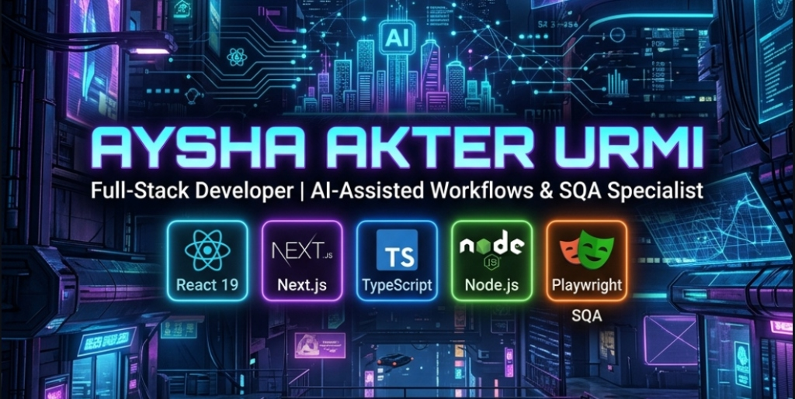

  

<h1 align="center">Hi 👋, I'm Aysha Akter Urmi</h1>
<h3 align="center">Full-Stack Developer | SQA Specialist | AI-Assisted Workflows</h3>

  

 
  

  
  
  
  

---

### 🌍 About Me

- 📍 **Based in:** Chittagong, Bangladesh  
- 💼 **Current Role:** Software Engineer at **Dorik AI Builder** — actively contributing across multiple domains of the product:
  - 🎨 **Frontend Engineering:** Crafting responsive, intuitive user interfaces and builder features using modern React and TypeScript.
  - ⚙️ **Backend & Services:** Developing reliable API endpoints, server-side logic, and database operations.
  - 🧪 **Software Quality Assurance (SQA):** Designing test scenarios, ensuring product stability, automated E2E testing, and API verification.
- 🤝 **Community & Collaboration:** Collaborating with **Startup Chattogram** on tech initiatives and startup community projects.
- 🚀 **Specialization:** Full-Stack Web Development, Type-Safe Architectures, Automated Testing, and AI-Assisted Workflows.
- 🌱 **Currently Focused On:** Scalable Next.js App Router applications, Prisma ORM, Redis caching strategies, and robust automated test suites.
- 📧 **Get in Touch:** [ayshaismail021@gmail.com](mailto:ayshaismail021@gmail.com)

---

### 💻 My Tech Stack

#### 🚀 Frontend & UI

#### 🖥️ Backend, Databases & Caching

#### 🧪 Testing & Quality Assurance (SQA)

#### ☁️ Cloud, Integrations & Tooling

---

### 📊 GitHub Stats

  
  
    
  

---

### 🐍 Contribution Activity

  

---

### 🌟 Philosophy

> *"The best way to predict the future is to create it."*
